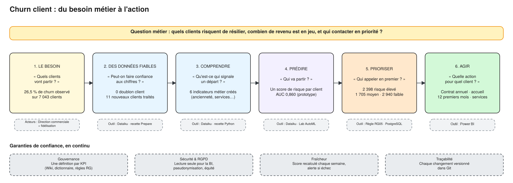
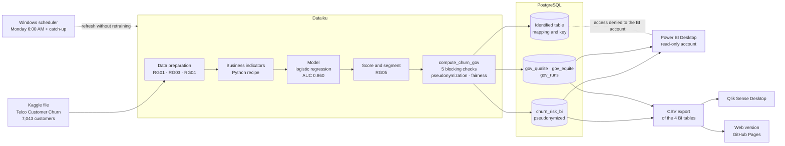
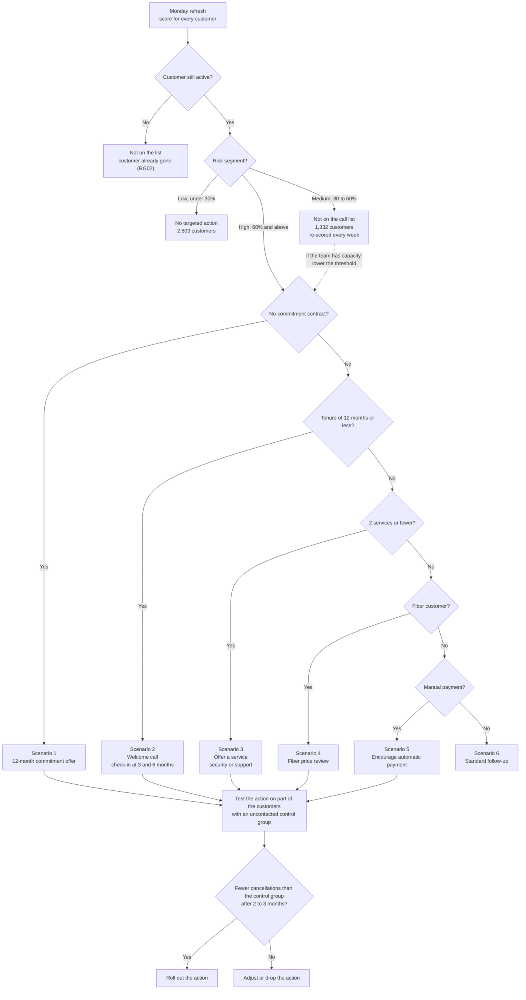

# Retention management: predicting customer churn

[Français](README.md) · **English**

**Open the interactive dashboard: https://cnanaj-wq.github.io/pilotage-fidelisation/** (in French)

## The project

An end-to-end demonstrator, from the business question to the retention team's call list.
It is built on the public Telco Customer Churn dataset (7,043 customers of a telecom operator) and
chains Dataiku, PostgreSQL, Power BI and Qlik Sense.

This repository holds the web version of the dashboard: the same data and the same rules as the Power BI
and Qlik Sense reports, available online with no license required.

## The business need

In a subscription business, cancellation almost always comes as a surprise: by the time the customer calls
to leave, it is too late. A classic dashboard tells you how many customers were lost last month.
It describes the past; it does not help you act.

The project answers three questions from the sales department and the retention team:

1. Which customers are likely to cancel?
2. How much monthly revenue is at stake?
3. Who should be contacted first, and with which action?

The starting point: 1,869 of 7,043 customers cancelled, a 26.5% churn rate, one customer in four.

## The solution

| Step | What was done | Tool |
|---|---|---|
| Reliable data | Written business rules (RG01 to RG10), no duplicates, 11 new customers kept instead of deleted | Dataiku |
| Understand | 6 business indicators: tenure, number of services, bill increase, no-commitment contract… | Dataiku, Python |
| Predict | A risk score per customer; logistic regression chosen because it is easy to explain (AUC 0.860 on 1,394 test customers) | Dataiku |
| Prioritize | High (≥ 60%), medium and low segments, published in a pseudonymized table | PostgreSQL |
| Act | One suggested action per customer: commitment offer, welcome call, fiber price review… | Power BI, Qlik Sense |

Trust safeguards around the pipeline:

- **Governance:** one written definition per KPI, a data dictionary and business rules.
- **Security:** read-only BI account, pseudonymized customer codes (HMAC-SHA256), no gender or age on the BI side.
- **Freshness:** scheduled refresh every Monday, blocking quality checks and an alert on failure.
- **Fairness:** a check compares targeting by gender and by senior status and flags gaps for a business decision.

## Architecture

- **A single source for BI:** Power BI, Qlik Sense and the web version read the same tables. No tool
  recomputes the score.
- **Identified data stays upstream:** the BI account reads only the pseudonymized table and the control
  tables. The database denies it the identified table, the mapping table and the key.
- **A refresh every Monday at 6:00 AM:** the pipeline runs in 3 min 30 s and catches up at the next login if the
  PC was off. It is idempotent: run three times, it returns the same figures.

### Operating scenarios

| Situation | What happens | What the user sees |
|---|---|---|
| Successful refresh | The BI tables and control tables are replaced | Log shows "Réussi" (success), last refresh date is current |
| Data quality issue (duplicate, negative charge…) | The pipeline stops before writing | BI keeps the last clean version, the issue shows in the checks |
| Pipeline failure | Error code, alert file, log entry and Windows notification | Log shows "Échec" (failure), the table read by BI is untouched |
| No successful refresh for more than 7 days (RG08) | Nothing is recomputed | The Governance page flags a call list that is out of date |
| Fairness gap (ratio < 0.80 or recall gap > 10 points) | Measured at every refresh | The alert stays visible until the business decides |

## Retention flowchart

Every week, each customer gets a score, a segment and one single action. Rules apply in order:
the first one that matches wins.

### The scenarios

Of the 5,174 active customers, 1,039 are high risk and go on the call list:

| Scenario | Who | Action | Customers | Monthly revenue | Tracking indicator |
|---|---|---|---:|---:|---|
| 1. Commitment | High risk, no-commitment contract | Offer to switch to 12 months with a benefit | 1,011 | $77,128 | Conversion rate to annual |
| 2. Welcome | High risk, committed, tenure of 12 months or less | Welcome call, check-in at 3 and 6 months | 7 | $583 | Churn of customers under one year |
| 3. Equipment | High risk, committed, long-standing, 2 services or fewer | Offer security or support for a few months | 0 | $0 | Average number of services |
| 4. Fiber price | High risk, committed, long-standing, well equipped, fiber | Targeted price review | 21 | $2,116 | Churn of fiber customers |
| 5. Payment | High risk, other cases, manual payment | Encourage automatic payment | 0 | $0 | Share of automatic payments |
| 6. Standard follow-up | High risk, none of the above | No specific action | 0 | $0 | – |
| **Total** | | | **1,039** | **$79,828** | |

Scenarios 3, 5 and 6 cover no high-risk customer today: almost all of them have no commitment and are taken
by scenario 1. The rules stay in place for future refreshes, or for when the business lowers the threshold
and brings in part of the 1,332 medium-risk customers.

Medium- and low-risk customers are not called: their suggested action is computed but not triggered.
Customers who have already left are excluded from the list.

The 60% threshold is a proposal to calibrate against call capacity: at 75%, the list drops to 443 active
customers.

## Business impact

- **A work list instead of a report:** 1,039 high-risk active customers, ranked from most to least likely to
  leave, each with a suggested action.
- **Revenue at stake, quantified:** $79,828 of monthly revenue at risk, 25.2% of active customers' revenue.
- **Efficient targeting:** on test customers, calling about one third of the customers would have reached
  three quarters of the leavers (75.7%).
- **A priority lever identified:** a customer with no commitment leaves 15 times more often than a customer on
  a two-year contract (42.7% vs. 2.8%). 1,011 of the 1,039 priority customers fall under the commitment offer.
- **Figures nobody disputes:** Power BI and Qlik Sense show the same values, checked against the database
  (21 values compared, 21 identical).
- **A risk made visible:** the targeting gap on senior customers (ratio 0.48) is displayed so the business can
  decide, instead of staying hidden in the model.

These results come from public sample data: this is a demonstrator, not a client case. Revenue at risk is an
order of magnitude, not a forecast loss. The real effect of each action is measured by testing it against a
control group.

## The online dashboard

- Four pages: Synthèse (summary), Par segment (by segment), Plan d'action (action plan), Gouvernance (governance).
- Cross-filtering as in Qlik Sense: clicking a bar filters every page.
- Sortable call list with search and CSV export.
- Each page also shows the same screen in Power BI and in Qlik Sense.

The site is written in HTML, CSS and JavaScript, with no external library. To try it on your computer:
download the repository, run `python -m http.server` in the folder, then open http://localhost:8000.

## Data source

Public Telco Customer Churn dataset, published on Kaggle and derived from IBM sample datasets:
https://www.kaggle.com/datasets/blastchar/telco-customer-churn

Cédric NANA, Data Analytics consultant.
