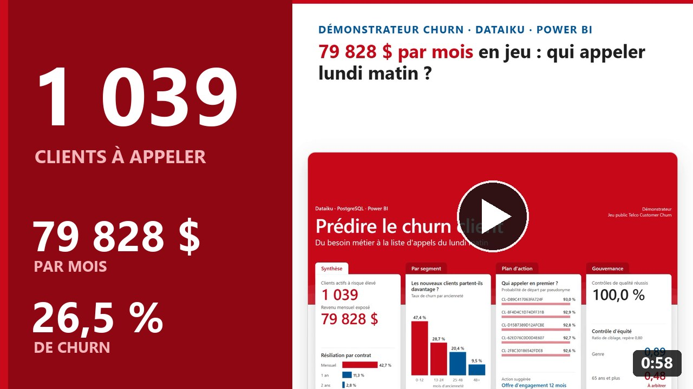
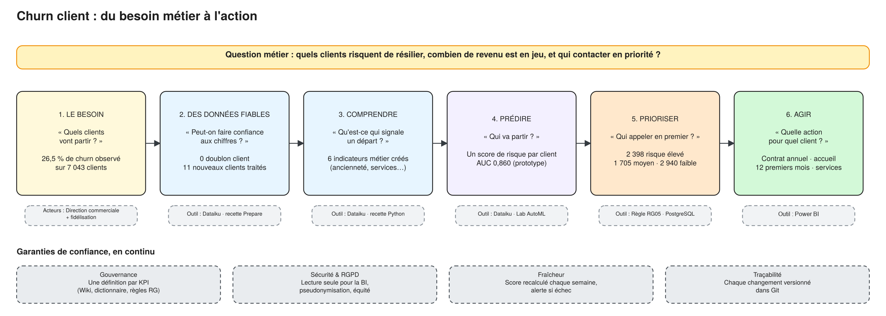
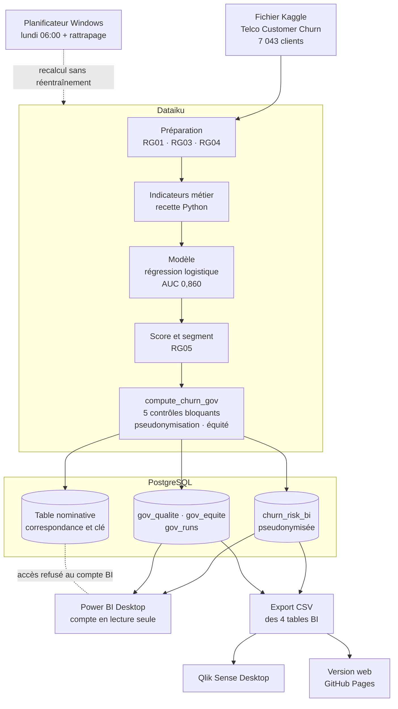
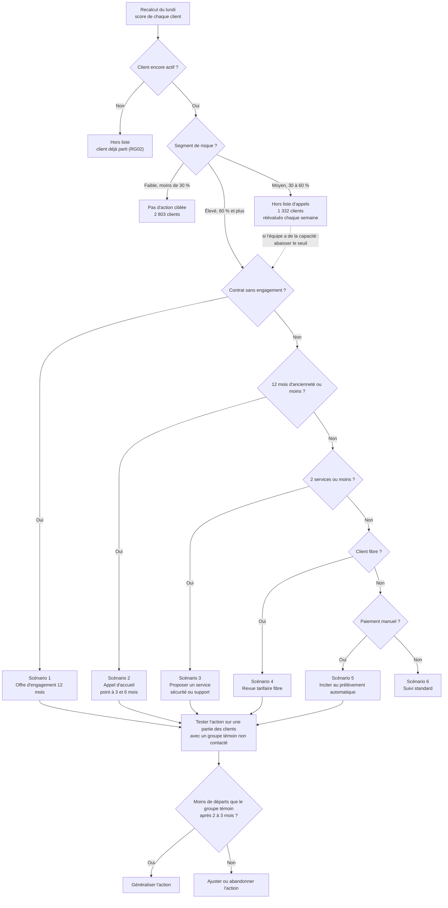

# Pilotage de la fidélisation : prédire le churn client

&nbsp;

## Le projet en vidéo

<table>
  <tr>
    <td width="420">
      
    </td>
    <td>
      <a href="https://cnanaj-wq.github.io/pilotage-fidelisation/video.html"><b>79 828 $ par mois en jeu : qui appeler lundi matin ?</b></a>  
      Cédric NANA · Consultant Data Analytics 
      ▷ 0:58 · vidéo en français  
      Dataiku prédit, PostgreSQL stocke, Power BI et Qlik Sense restituent : le projet en moins d'une minute.
    </td>
  </tr>
</table>

**Voir le dashboard interactif : https://cnanaj-wq.github.io/pilotage-fidelisation/**

## Le projet

Un démonstrateur de bout en bout, de la question métier jusqu'à la liste d'appels de l'équipe fidélisation.
Il s'appuie sur le jeu de données public Telco Customer Churn (7 043 clients d'un opérateur télécom) et
enchaîne Dataiku, PostgreSQL, Power BI et Qlik Sense.

Ce dépôt contient la version web du dashboard : les mêmes données et les mêmes règles que les rapports
Power BI et Qlik Sense, consultables en ligne sans licence.

## Le besoin métier

Dans un abonnement, la résiliation arrive presque toujours comme une surprise : quand le client appelle pour
partir, il est trop tard. Un tableau de bord classique dit combien de clients ont été perdus le mois dernier.
Il permet de constater, pas d'agir.

Le projet répond à trois questions de la direction commerciale et de l'équipe fidélisation :

1. Quels clients risquent de résilier ?
2. Combien de revenu mensuel est en jeu ?
3. Qui contacter en priorité, et avec quelle action ?

Le point de départ : 1 869 clients sur 7 043 ont résilié, soit 26,5 %, un client sur quatre.

## La solution mise en place

| Étape | Ce qui a été fait | Outil |
|---|---|---|
| Des données fiables | Règles de gestion écrites (RG01 à RG10), aucun doublon, 11 nouveaux clients conservés au lieu d'être supprimés | Dataiku |
| Comprendre | 6 indicateurs métier : ancienneté, nombre de services, hausse de facture, contrat sans engagement… | Dataiku, Python |
| Prédire | Un score de risque par client, régression logistique retenue pour sa lisibilité (AUC 0,860 sur 1 394 clients test) | Dataiku |
| Prioriser | Segments élevé (≥ 60 %), moyen et faible, publiés dans une table pseudonymisée | PostgreSQL |
| Agir | Une action suggérée par client : offre d'engagement, appel d'accueil, revue tarifaire fibre… | Power BI, Qlik Sense |

Autour de la chaîne, des garanties de confiance :

- **Gouvernance :** une définition écrite par KPI, un dictionnaire et des règles de gestion.
- **Sécurité :** compte BI en lecture seule, codes clients pseudonymisés (HMAC-SHA256), sans genre ni âge côté BI.
- **Fraîcheur :** recalcul planifié chaque lundi, contrôles qualité bloquants et alerte en cas d'échec.
- **Équité :** un contrôle compare le ciblage par genre et par statut senior, et signale les écarts à arbitrer.

## L'architecture

- **Une seule source pour la BI :** Power BI, Qlik Sense et la version web lisent les mêmes tables. Aucun outil
  ne recalcule le score.
- **Les données nominatives restent en amont :** le compte BI ne lit que la table pseudonymisée et les tables
  de contrôle. La base lui refuse la table nominative, la table de correspondance et la clé.
- **Un recalcul chaque lundi à 6 h :** la chaîne tourne en 3 min 30, rattrapée à l'ouverture de session si le
  PC était éteint. Elle est idempotente : rejouée trois fois, elle redonne les mêmes chiffres.

### Scénarios de fonctionnement

| Situation | Ce qui se passe | Ce que voit l'utilisateur |
|---|---|---|
| Recalcul réussi | Les tables BI et les tables de contrôle sont remplacées | Journal « Réussi », date du dernier calcul à jour |
| Anomalie de qualité (doublon, charge négative…) | Le traitement s'arrête avant d'écrire | La BI garde la dernière version saine, l'anomalie apparaît dans les contrôles |
| Panne du traitement | Code d'échec, fichier d'alerte, ligne au journal et notification Windows | Journal « Échec », la table lue par la BI reste intacte |
| Plus de 7 jours sans calcul réussi (RG08) | Rien n'est recalculé | La page Gouvernance signale une liste qui n'est plus à jour |
| Écart d'équité (ratio < 0,80 ou rappel > 10 points) | Le contrôle le mesure à chaque calcul | L'alerte reste affichée jusqu'à l'arbitrage du métier |

## Le logigramme de fidélisation

Chaque semaine, chaque client reçoit un score, un segment et une seule action. Les règles s'appliquent dans
l'ordre : la première qui correspond l'emporte.

### Les scénarios

Sur les 5 174 clients actifs, 1 039 sont à risque élevé et entrent dans la liste d'appels :

| Scénario | Qui est concerné | Action | Clients | Revenu mensuel | Indicateur de suivi |
|---|---|---|---:|---:|---|
| 1. Engagement | Risque élevé, contrat sans engagement | Offre de passage à 12 mois avec un avantage | 1 011 | 77 128 $ | Taux de conversion vers l'annuel |
| 2. Accueil | Risque élevé, engagé, 12 mois d'ancienneté ou moins | Appel de bienvenue, point à 3 et 6 mois | 7 | 583 $ | Churn des clients de moins d'un an |
| 3. Équipement | Risque élevé, engagé, ancien, 2 services ou moins | Offrir l'option sécurité ou support quelques mois | 0 | 0 $ | Nombre moyen de services |
| 4. Prix fibre | Risque élevé, engagé, ancien, bien équipé, fibre | Revue tarifaire ciblée | 21 | 2 116 $ | Churn des clients fibre |
| 5. Paiement | Risque élevé, autres cas, paiement manuel | Inciter au prélèvement automatique | 0 | 0 $ | Part de paiements automatiques |
| 6. Suivi standard | Risque élevé, aucun des cas précédents | Pas d'action particulière | 0 | 0 $ | – |
| **Total** | | | **1 039** | **79 828 $** | |

Les scénarios 3, 5 et 6 ne concernent aucun client à risque élevé aujourd'hui : presque tous sont sans
engagement et sont pris par le scénario 1. Les règles restent en place pour les prochains recalculs, ou si le
métier abaisse le seuil et intègre une partie des 1 332 clients à risque moyen.

Les clients à risque moyen et faible ne sont pas appelés : leur action suggérée est calculée, mais elle n'est
pas déclenchée. Les clients déjà partis sont exclus de la liste.

Le seuil de 60 % est une proposition à calibrer selon la capacité d'appel : à 75 %, la liste tombe à 443 clients
actifs.

## L'impact métier

- **Une liste de travail au lieu d'un constat :** 1 039 clients actifs à risque élevé, classés du plus au moins
  probable, chacun avec une action proposée.
- **Le revenu en jeu, chiffré :** 79 828 $ de revenu mensuel exposé, soit 25,2 % du revenu des clients actifs.
- **Un ciblage efficace :** sur les clients test, appeler environ un tiers des clients aurait permis de toucher
  les trois quarts des départs (75,7 %).
- **Un levier prioritaire identifié :** un client sans engagement part 15 fois plus souvent qu'un client engagé
  deux ans (42,7 % contre 2,8 %). 1 011 des 1 039 clients prioritaires relèvent de l'offre d'engagement.
- **Des chiffres qui ne se discutent plus :** Power BI et Qlik Sense affichent les mêmes valeurs, contrôlées
  contre la base (21 valeurs comparées, 21 identiques).
- **Un risque rendu visible :** l'écart de ciblage sur les clients seniors (ratio 0,48) est affiché pour que le
  métier décide, au lieu de rester caché dans le modèle.

Ces résultats viennent de données publiques d'exemple : c'est un démonstrateur, pas un cas client. Le revenu
exposé est un ordre de grandeur, pas une perte prévue. L'effet réel des actions se mesure en les testant face à
un groupe témoin.

## Le dashboard en ligne

- Quatre pages : Synthèse, Par segment, Plan d'action, Gouvernance.
- Sélection croisée comme dans Qlik Sense : un clic sur une barre filtre toutes les pages.
- Liste des clients à appeler, triable, avec recherche et export CSV.
- Chaque page montre aussi le même écran dans Power BI et dans Qlik Sense.

Le site est écrit en HTML, CSS et JavaScript, sans bibliothèque externe. Pour l'essayer sur votre ordinateur :
téléchargez le dépôt, lancez `python -m http.server` dans le dossier, puis ouvrez http://localhost:8000.

## Source des données

Jeu de données public Telco Customer Churn, publié sur Kaggle et issu des jeux de données d'exemple d'IBM :
https://www.kaggle.com/datasets/blastchar/telco-customer-churn

Cédric NANA, consultant Data Analytics.
